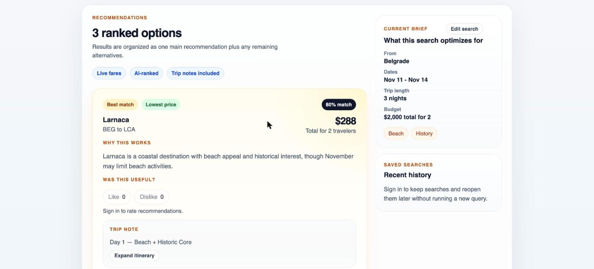

# tickets_app

Flight-based trip inspiration. Enter an origin city, travel dates, a total budget
and a few themes (beach, history, gastronomy, ...), and get a short ranked list of
destinations built from real fares, with trip notes for each one.

> Status: MVP, built for local development.



## How it works

1. **Fares.** Candidate flights come from the Travelpayouts / Aviasales API for
   the origin city's airports and are filtered by budget and dates.
2. **Shortlist.** Candidates are deduplicated and scored on facts (price, fit to budget).
3. **LLM ranking.** OpenAI scores the shortlist against the chosen themes and writes
   trip notes and "how to improve your search" hints.
4. **Result.** Factual and semantic scores are combined into a short ranked list.
   If an LLM call fails, the app falls back to rule-based ranking and says so in the response.

Signed-in users get every search saved automatically and can like or dislike suggestions.

Current limits: fixed travel dates only (flexible dates are not implemented yet), and the
UI searches for two travelers.

## Stack

| Part | Technology |
| --- | --- |
| Frontend | React 19, Vite |
| Backend | FastAPI, SQLModel, Alembic, Python 3.12 |
| Python tooling | [uv](https://docs.astral.sh/uv/), ruff, mypy, pytest |
| Database | PostgreSQL 16 |
| Infra | Docker Compose (development setup) |

The backend follows a layered layout (`api`, `application`, `domain`, `infrastructure`).
See [docs/app_tree.md](docs/app_tree.md).

## Getting started

### Requirements
- Docker with Compose
- [uv](https://docs.astral.sh/uv/), only if you want a local `.venv` for your IDE
- A [Travelpayouts](https://www.travelpayouts.com/) API token and an OpenAI API key.
  Search needs both; without them it returns an error.

### Run
```bash
make init            # create .env from .env.example
# edit .env: set TRAVELPAYOUTS_API_TOKEN and OPENAI_API_KEY
make up              # start postgres, backend and frontend
make be-db-upgrade   # apply database migrations
make be-sync-iata    # load the IATA/city dataset (needs internet access)
```

Then open:
- Frontend: <http://localhost:3100>
- API docs: <http://localhost:8100/docs>
- Health check: <http://localhost:8100/health>

The Docker setup is for development only: the backend runs with `--reload`, the
frontend runs the Vite dev server, and the source folders are mounted into the
containers. The database credentials in `.env.example` are local defaults, so
change them before using this setup anywhere else.

## Development

Run `make` targets from the repository root. Backend commands run inside the container.

| Command | What it does |
| --- | --- |
| `make up` / `make up-build` / `make down` | Start (optionally rebuild) / stop the stack |
| `make ps` / `make logs` | Show containers / follow logs |
| `make be-deps` | Sync a local `.venv` and rebuild the backend image |
| `make be-check` | Lint, format check, mypy and tests. Run before committing |
| `make be-test` / `make be-lint` / `make be-mypy` | Individual backend checks |
| `make be-format` | Apply ruff fixes and formatting |
| `make be-db-upgrade` / `make be-db-current` | Apply migrations / show the current revision |
| `make be-sync-iata` | Sync the IATA/city dataset into the database |
| `make fe-lint` | ESLint and Prettier check |
| `make fe-format` | Apply ESLint fixes and Prettier formatting |
| `make fe-build` | Production build of the frontend |

### Dependencies
- Backend: `apps/backend/pyproject.toml` and `uv.lock` are the source of truth.
  The Docker image installs them with `uv sync --frozen`.
- Frontend: `apps/frontend/package.json` and `package-lock.json`, installed with `npm ci`.

### CI
GitHub Actions runs on every push and pull request:
- Backend: `uv sync --frozen`, ruff (lint and format), mypy, pytest.
- Frontend: `npm ci`, ESLint, Prettier check, build.

## API

Interactive documentation is served at `/docs`.

| Method | Path | Description |
| --- | --- | --- |
| GET | `/health` | Liveness check |
| POST | `/auth/register`, `/auth/login` | Create an account / sign in, returns an access token |
| GET | `/auth/me` | Current user |
| POST | `/auth/logout` | End the session |
| POST | `/search` | Run a search (saved when signed in) |
| GET | `/searches`, `/searches/{id}` | List / open saved searches |
| POST | `/search/suggestions/{id}/reaction` | Like or dislike a suggestion |

Example request:
```json
{
  "origin_city": "Belgrade",
  "dates_mode": "strict",
  "strict_dates": { "start_date": "2026-06-10", "end_date": "2026-06-17" },
  "themes": ["beach", "history"],
  "budget_usd": 2000,
  "travelers_count": 2
}
```
Authenticated requests send `Authorization: Bearer <access_token>`.

## License

[MIT](LICENSE)
